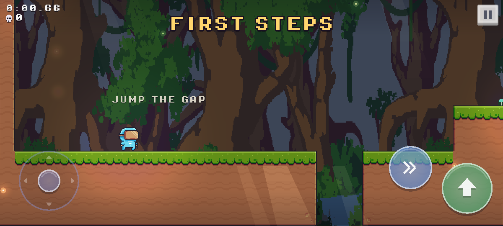
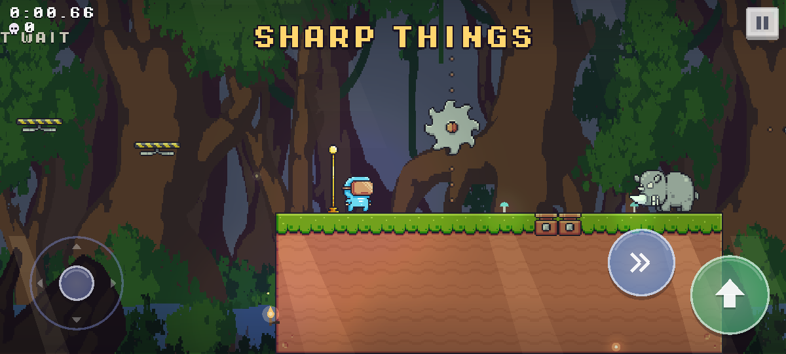
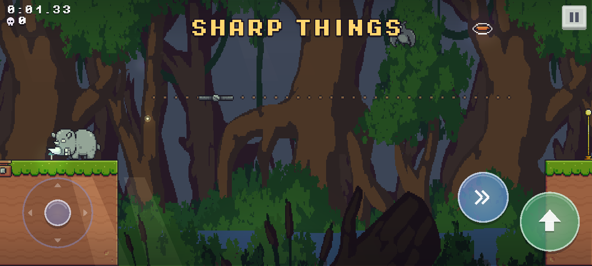
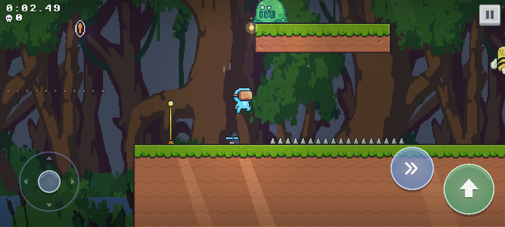

# Lumi & the Hollow

A cozy, hard little platformer for Android phones. Lumi is a small light, and
the Hollow under the town of Greyreach goes down in layers: a garden, a
drowned town, a warm heart of embers, each with something keeping the way
down. Dash, wall-jump, swim and bounce your way to the bottom; one touch of
anything sharp and you are back at the last lantern, with the clock still
running.

Built in [Odin](https://odin-lang.org) on [raylib](https://www.raylib.com), as
a NativeActivity with no Java.

| | |
|---|---|
|  |  |
|  |  |

## Play it

Download `lumi-<version>.apk` from the [Releases](../../releases) page and
open it on the phone (Android 10 or newer, arm64); the phone will ask to allow
installs from wherever you opened it. Every push to `main` also builds an APK,
attached to its run on the [Actions](../../actions) page.

## Controls

| Phone | | Keyboard (development) |
|---|---|---|
| left thumb, anywhere on the left half | move | `A` `D` / arrows |
| the same stick, any of eight ways | aim the dash; pulled down, drop through a platform. A wedge on the rim shows where a dash would go | `W` `S` / arrows |
| the green button | jump, and off walls. On a phone every jump is full height | `Space` (or `C`, `J`); let go early for a short hop |
| the blue button | dash; dimmed while it is spent | `Shift` (or `X`, `K`) |
| Back, or the pause button in the corner | pause | `P` / `Esc` |

The phone buzzes on a dash, when you land on a creature, at a checkpoint, on
a death and at the end of a level.

On the world map, tap a level to pick it and tap it again (or PLAY) to go;
the arrows by the title turn to the next world, HERO picks who you play as.
On a keyboard: left and right, `Q` `E` for worlds, `Enter`, `H`, `Esc`.

## The worlds

- **The Moss** (1-1 to 1-5): the basics, trampolines, fans, creatures, and at
  the end the Ooze King.
- **The Drowned Halls** (2-1 to 2-5): water you can swim in. You sink
  slowly, jump strokes you upward, a stroke at the surface throws you out,
  and the water gives your dash back. Underwater tunnels, walls to dive
  under, spiked heads, a lift, and the Broodmother.
- **The Ember Deep** (3-1 to 3-5): the liquid is lava and kills. Geysers
  bubble, then erupt and throw you high; fire, saws over lava, a climb up a
  chimney of ash, a gauntlet of everything, and the Warden.

## Bosses

The last level of each world. No gun: every boss is beaten by landing on it
at the right moment, and every move it makes is telegraphed. The exit stays
shut until it is down; dying puts it back at full strength.

- **The Ooze King** (1-5). It squats, then hops at you, and every landing
  sends a ripple along the floor to jump. Just after it lands it sags, open:
  land on it. Three hits; each makes it smaller and quicker, and from the
  second on it sheds little slimes. A hit throws you clear.
- **The Broodmother** (2-5). She sweeps the top of the arena, screeches and
  flushes red as she picks her spot, then dives at where you are: step
  aside. Crashing into the floor stuns her. From the second hit she calls her
  young.
- **The Warden** (3-5). It paws the ground, then charges the length of the
  arena: jump it. It crashes into the wall behind you and is dazed for long
  enough to run the arena. Once hit, every crash shakes rocks loose, marked
  where they will land, and always behind you, so stepping out from under
  them takes you toward it.

While a boss is stunned, or recovering, bumping into it is harmless.

## Things to find and break

- **Gems.** Strung along good paths and spilling out of crates. Pick a run of
  them up quickly and each one rings a note higher. They stay picked up when
  you die; the clear card counts them, and the map keeps your best.
- **Crates.** Dash into one, dash down onto one, or jump into it from below
  and it bursts into three gems.
- **Combos.** Land on creature after creature, or a creature and a
  trampoline, without touching the ground: each bounce is called out (x2,
  x3...) and pitched higher.

## The map, fruit and medals

- **Worlds and levels.** A level opens when the one before it is cleared; a
  world opens when the last level of the world before it is. Your progress is
  saved on the phone as you go.
- **Fruit.** Hidden around each level. Touch one and it follows you; it is
  only yours once you have stood on solid ground with it for a moment, or
  reached a checkpoint or the end. Die first and it goes back.
- **Medals.** Three per level, shown as dots under it on the map: finish
  inside the par time, finish without dying, keep every fruit.
- **Secret exits.** Some levels hide a second way out, a purple trophy. It
  finishes the level and opens a hidden level on the map. There is one in 1-1.
- **Heroes.** Virtual Guy from the start; Ninja Frog for 5 fruit, Pink Man for
  6 medals, Mask Dude for beating a secret level.

## Movement

- **The dash.** One per time in the air, back when you land; the body turns
  blue while it is spent and flashes when it comes back. Eight directions,
  about four tiles on its own, and the world stops for a beat when it starts.
- **Super and hyper jumps.** Jump while a sideways dash is still touching the
  ground and it becomes a long, fast jump; from a dash diagonally down it is a
  lower, longer one. Either gives the dash straight back.
- **Wall jumps.** Off any wall you are touching, or within three pixels of. A
  wall jump cancels a dash, so you can dash into a wall and kick off it.
- **Forgiving edges.** Coyote time and jump buffering forgive a press that is a
  little early or late, a jump that ends a few pixels under a ledge is lifted
  onto it, a head that clips a corner slides past it, and gravity eases off at
  the top of a held jump. Spikes only hurt in the half against their rock.
- **Numbers.** A jump clears four and a half tiles up and about six and a half
  across at a run; jump and dash at the top about nine; jump and dash straight
  up about eight high.

## Where it is

The project started as Oddy, a procedural run-based shooter for desktop (that
version is tagged `shooter-final`). It is being rebuilt as a hand-made world-map
platformer for phones: three worlds of five levels each, the last of each a
boss you beat without a gun.

1. **Movement** — done: coyote time, jump buffering, variable jump height,
   wall jumps, an 8-way dash, super and hyper jumps, one-hit deaths with an
   instant respawn.
2. **LDtk levels** — done: `levels/lumi.ldtk`.
3. **Traps, moving pieces and creatures** — done: saws, moving and falling
   platforms, trampolines, fans, fire, arrow shooters, dash balloons, a
   spiked head that drops on you; pigs, slimes, rinos, bats and bees to land
   on. Levels 1-1 to 1-3.
4. **Feel** — done: squash and stretch, dust, puffs to vanish and arrive in,
   an iris on every death and respawn, CC0 sound effects, vibration, gems,
   crates, combos, confetti, butterflies and birds, flowers in the breeze.
5. **The map** — done: the world map, saving, fruit, medals, secret exits
   (1-1 hides one, into the secret level 1-S), four heroes.
6. **Levels and bosses** — done: three worlds of five levels, a secret
   level, swimming, geysers, and three bosses.
7. **Polish** — done: a track per world and one for the bosses
   (crossfading, quieter while paused), a story told in a few lines on the
   map and at the very end, fades between screens, and a launcher icon of
   the hero dashing over the meadow.
8. The name.

## Building

```
tools/build_raylib.sh android    # once: raylib for arm64, with the NDK
tools/build_android.sh           # build/lumi.apk
tools/build_android.sh run       # ...then install it on the connected phone and start it
```

Needs [Odin](https://odin-lang.org) (`dev-2026-10`, as CI uses), the Android
SDK (build-tools, a platform, the NDK) under `ANDROID_HOME` or
`~/Android/Sdk`, and a JDK for `apksigner`. The script signs with the debug key
Android Studio makes, or with `ODDY_KEYSTORE` (password `ODDY_KEYSTORE_PASS`).

CI (`.github/workflows/android.yml`) does the same on GitHub's runners for
every push and pull request, and for a tag `v*` puts the APK on a release. With
repository secrets `ODDY_KEYSTORE_B64` (the keystore, base64) and
`ODDY_KEYSTORE_PASS` it signs with that key, so each release installs over the
last; without them every build is signed with a throwaway key and has to be
installed fresh.

### On the desktop, for development

The same code runs in a window on Linux, which is the quick way to work on
levels and movement. It is a development tool, not a release.

```
tools/build_raylib.sh linux      # once
odin run src -out:lumi           # keyboard
odin run src -out:lumi -define:TOUCH=true   # the phone's touch layout, with the mouse as one finger
```

Run it from the repo root (asset paths are relative). `F5` reads the levels
file again, `F11` toggles fullscreen.

`tools/dev/shots.sh` builds a screenshot mode (`-define:SHOTS=true`, see
`src/devshots.odin`) that plays a fixed script and saves pictures to
`build/shots/`; add `-define:TOUCH=true` for the phone's layout.

## Editing levels

The levels live in one [LDtk](https://ldtk.io) project, `levels/lumi.ldtk`,
and are played in the order LDtk lists them. Open it in LDtk 1.5, draw, save,
and press `F5` in the running game: it reads the file again and restarts the
level you are on.

- **Collision** (IntGrid, 16px): `1` rock, `2` one-way platform, `3` spikes
  (they point away from the rock beside them), `4` water, `5` crate. Only the shape is
  drawn; the game picks the grass, edges and corners itself from which
  neighbours are rock.
- **Entities**: `Player_Start` (one per level), `Checkpoint`, `Exit` (the
  trophy that finishes the level), `Hint`, a line of text floating in the
  level (its `Text` field), and the traps and creatures:

  | Entity | |
  |---|---|
  | `Saw` | resize it into a track; the saw runs end to end along its long side (`Speed`) |
  | `Moving_Platform` | the same, with a platform you can stand on |
  | `Falling_Platform` | drops a moment after you land on it, then grows back |
  | `Trampoline` | throws you high and gives the dash back |
  | `Fan` | blows you up as far as its height |
  | `Fire` | put it over a floor tile: it lights a moment after you step on it |
  | `Arrow_Shooter` | `Dir`, `Interval`, `Delay`; arrows fly about 18 tiles |
  | `Refill` | gives a spent dash back, then grows back |
  | `Spike_Head` | shudders, then drops when you are under it, and climbs back |
  | `Pig`, `Slime` | walk back and forth, turning at walls and edges |
  | `Rino` | charges when you are level with it, dazed when it hits a wall |
  | `Bat` | swings three tiles either side of where it is placed |
  | `Bee` | bobs up and down |
  | `Geyser` | bubbles, then erupts and throws you up to its height (`Delay`) |
  | `Ooze_King`, `Broodmother`, `Warden` | the bosses; the level's exit opens when it is beaten |

  Land on a creature to kill it: you bounce and get the dash back. Touching
  one any other way, or any trap, is a death. Everything is put back as it
  started each time you die.
  Two more for the map: `Fruit`, a collectible (its look is picked by the
  game), and `Secret_Exit`, a second way out whose `Unlocks` field names the
  secret level it opens. And the gems: `Gem` for one, `Gem_Line` for a row or
  column of them, one a tile along the rectangle's long side.
- **Level identifiers** place a level on the map: `W2_4` is world 2, level 4
  (1 to 5, the fifth is the boss); `W1_S1` is a secret level of world 1, shown
  above the level whose secret exit names it.
- **Level fields**: `Name`, shown when the level starts and on the clear card;
  `Zone` (`Mossy`, `Drowned`, `Ember`), which picks the colours, the light and
  what drifts through the air; and `Par`, the seconds to beat for the time
  medal.

Anything else in the file is ignored by the game. If the file cannot be read,
the game starts in a bare room whose hint says why.

## Layout

Code is one Odin package in `src/`. Odin makes a directory a package, and this
game is small enough and cross-referential enough that splitting it would buy
nothing but import cycles, so files are grouped by prefix instead.

| File | |
|---|---|
| `main.odin` | window setup and the main loop |
| `main_android.odin` | the entry point raylib calls on Android |
| `haptics.odin` | vibration on a phone (the C side is `android/native/haptics.c`) |
| `game.odin` | the `Game` struct, update order, draw order |
| `input.odin` | keyboard and touch, read into one `Input` per frame |
| `player.odin` | movement, jumps, the dash, death and respawn |
| `physics.odin` | axis-separated AABB vs tiles, one-way platforms |
| `ldtk.odin` | reading `levels/lumi.ldtk` |
| `level.odin` | the level being played: checkpoints, the exits, fruit, hints |
| `worldmap.odin` | the world map and the hero picker |
| `progress.odin` | what is open and what is earned: unlocks, medals, heroes |
| `save.odin` | the save file |
| `music.odin` | the tracks and the crossfade between them |
| `things.odin` | traps and moving pieces |
| `enemy.odin` | the creatures, and landing on them |
| `boss.odin` | the bosses, their floor ripples, the boss bar |
| `tilemap.odin` | tile grid, spikes, autotiling, grass and flowers, drawing |
| `camera.odin` | virtual resolution, the following camera, the parallax backdrops |
| `lighting.odin` | the light map and every light in it |
| `zone.odin` | the three worlds and how each one looks |
| `decor.odin` | torches, roots, stalactites, crystals, drifting motes |
| `atmosphere.odin` | sun shafts, the glow off water and lava |
| `fx.odin` | sparks and puffs: dust, dash bursts, the puff you vanish and arrive in |
| `lore.odin` | every line of prose in the game |
| `animation.odin` | sprite sheets and the animation player |
| `assets.odin` | every file the game loads, in one place |
| `hud.odin` | shared drawing helpers, the clock and the death count |
| `hud_touch.odin` | the on-screen stick and buttons |
| `hud_screens.odin` | title, how-to-play, pause and level-clear boards |
| `ui.odin` | menu buttons and boards: layout, press handling, nine-slicing |

Outside `src/`: `levels/` is the LDtk project, `android/` the manifest,
launcher icon and the native helper, `tools/` the build scripts,
`tools/art/` the Python that draws the terrain and backdrops (`python3
tools/art/make_art.py`, needs Pillow and NumPy), and
`.github/workflows/android.yml` the CI that builds the APK.

## raylib

The game links raylib 6.0 statically, built from raylib's source by
`tools/build_raylib.sh` into `libs/raylib/<platform>/` (the libraries are not
checked in). `libs/raylib/` also holds a copy of Odin's raylib bindings with the
library paths pointed there, so a build does not depend on what the system's
Odin or raylib package happens to ship.

## Credits

The worlds themselves (ground, grass and flowers, bridges, water, skies and
backdrops) and the launcher icon are drawn for the game by `tools/art/make_art.py`.
Music by Juhani Junkala (CC0). Characters and traps
are from Pixel Frog's Pixel Adventure 1 and 2 (CC-BY 4.0: heroes, creatures,
traps, fruit), menus from Kenney's
Pixel UI pack (CC0), sound effects from Juhani Junkala's Essential Retro Video
Game Sound Effects Collection (CC0). The full list, including what is still to
be replaced, is in `assets/CREDITS.md`.
