# Oddy

A 2D run-based platform shooter in Odin + raylib, for desktop and Android. Every
run builds a fresh network of rooms: find the rune-key, unseal the vault, and
break whatever is waiting in it.

```
tools/build_raylib.sh linux      # once: builds the raylib the game links
odin run src -out:oddy
```

Asset paths are relative to the working directory, so run it from the repo root.
For a phone, see [Android](#android).

## In motion

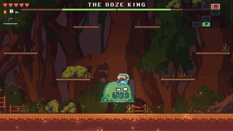

| | |
|---|---|
| 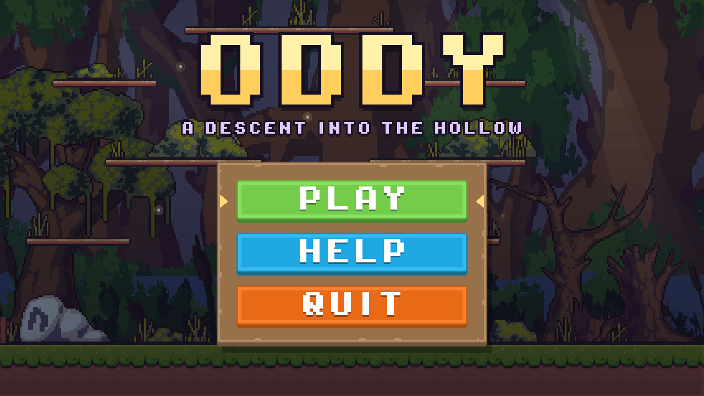 | 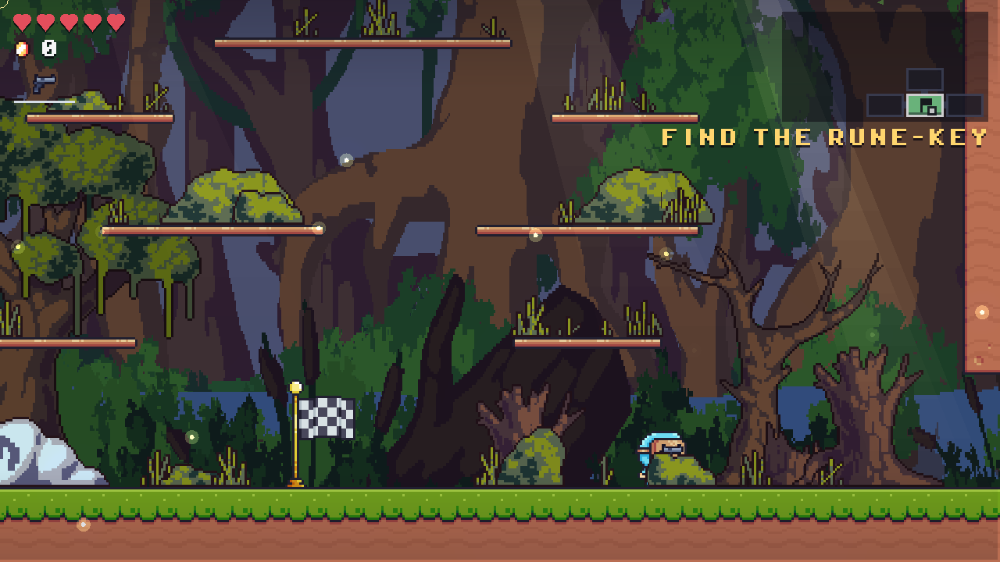 |
| The title: play, help, quit. | The way in: the moss, the flag, the map in the corner. |
| 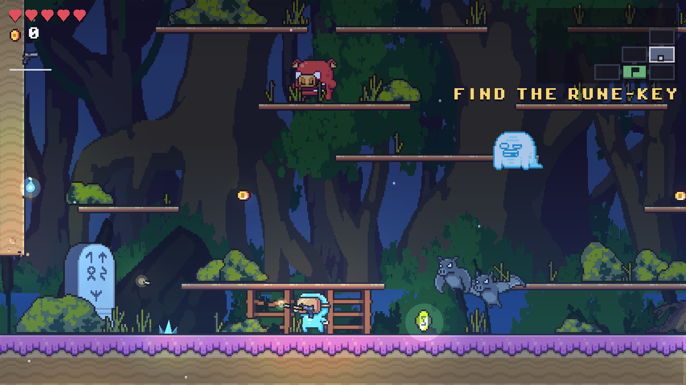 | 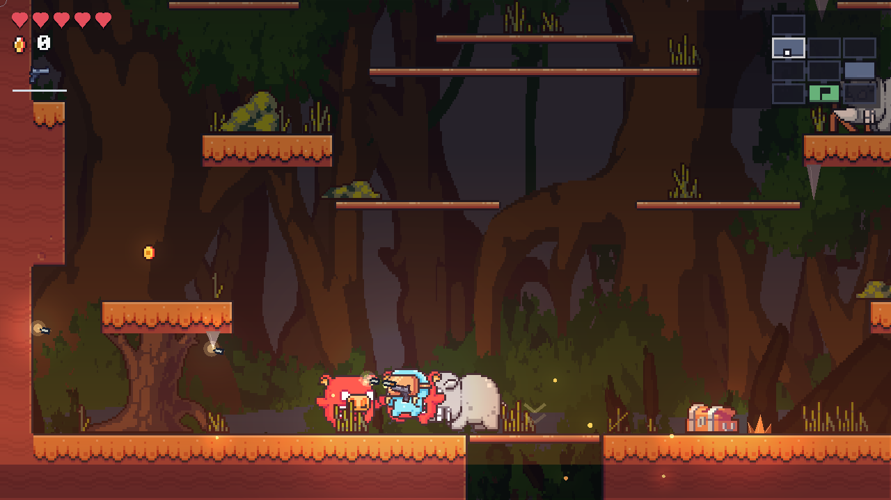 |
| Further down the rock turns blue and the ceilings drip. | At the bottom it turns red, and the water is lava. |
| 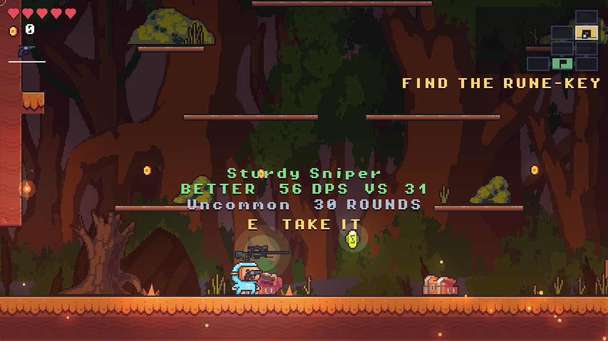 | 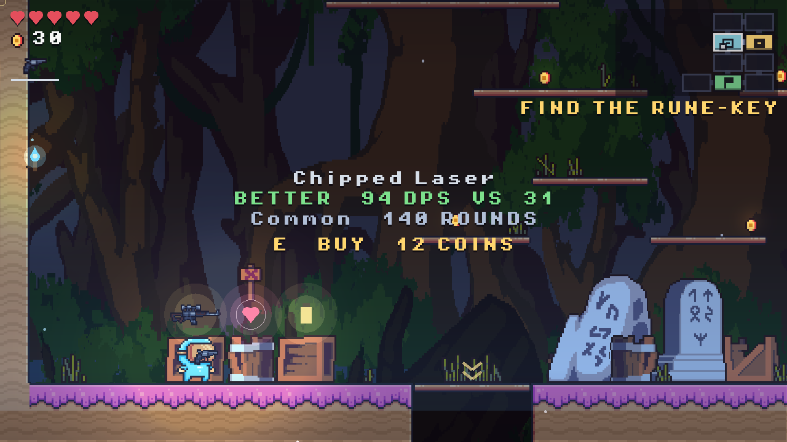 |
| A chest rolled a rifle, shown against what you hold. | The stall: three crates, never enough coins for all three. |
| 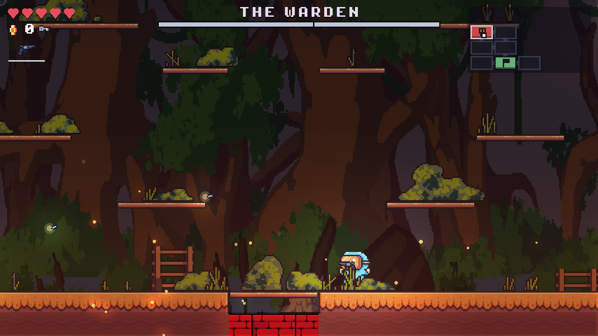 | 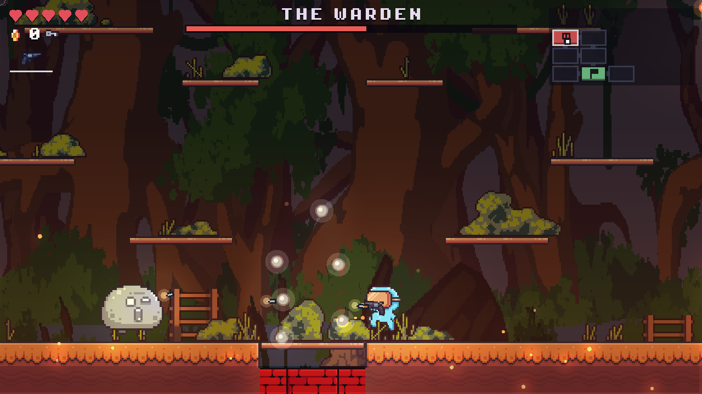 |
| The Warden in its armour. | Armour gone: it leaps, and the ceiling comes down. |
| 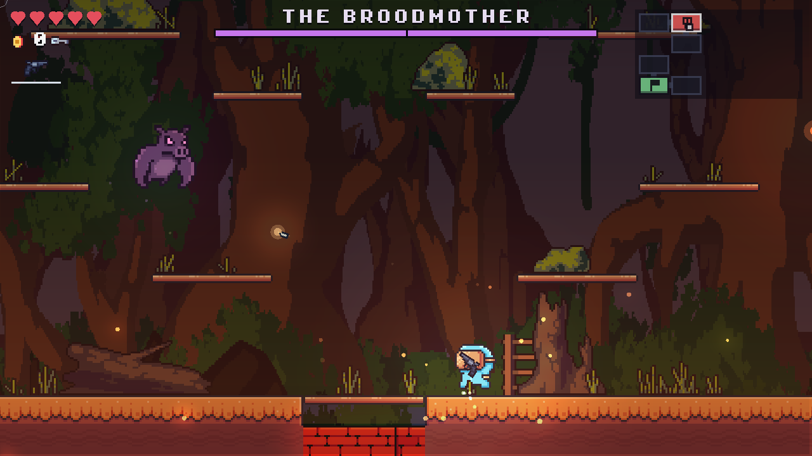 | 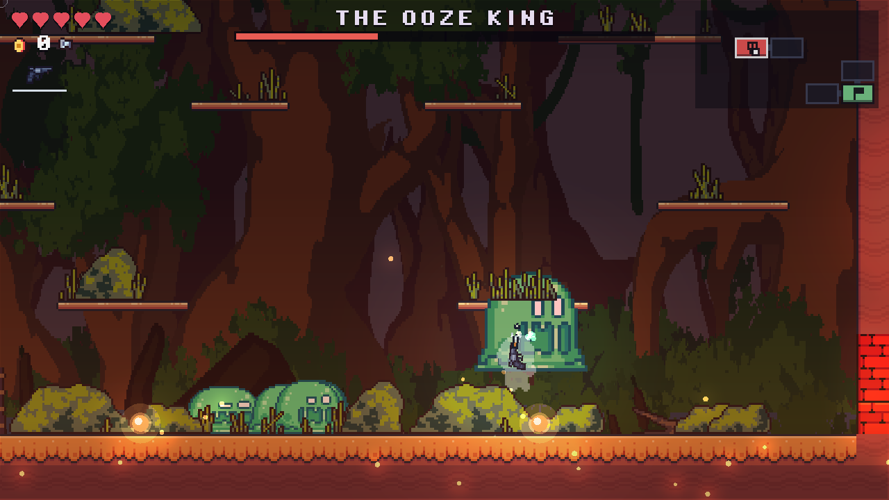 |
| The Broodmother screeches before she dives. | The Ooze King, past half, with every landing a wave. |
| 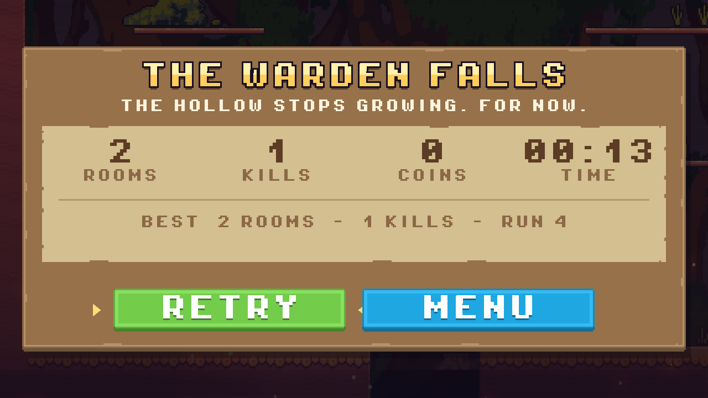 | 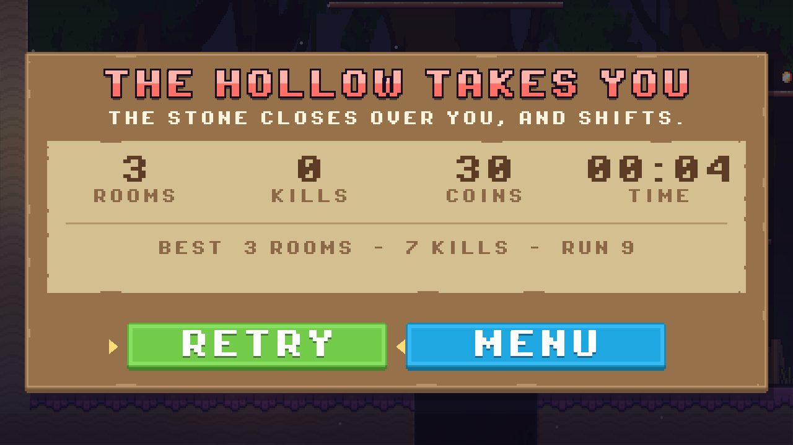 |
| The end of a run. | The other end of a run. |

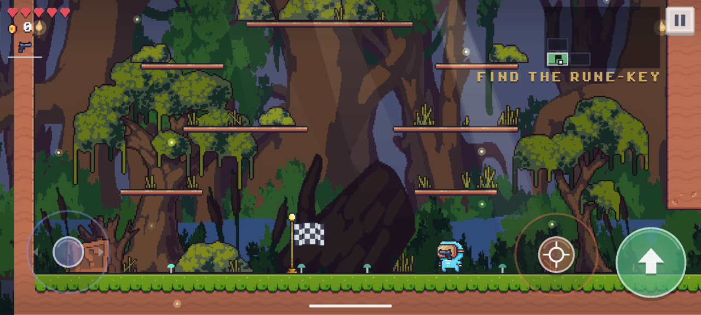

On a phone: a stick under the left thumb, an aim stick and a jump button under the right.

## The run

The Hollow under Greyreach took the mine, then the miners, then the town. At the
bottom of it something guards a vault — a different thing every descent — and
it has spent a century feeding the Hollow instead of keeping it sealed.

1. Explore the Hollow and find the **rune-key**.
2. The key unseals the **vault** — every door into it is barred until you have it.
3. **Break what is in the vault.** That is the way out.

Somewhere in the middle of the map there is a **stall**. It is the only place
coins are worth anything, and it never has enough on it to sell you everything.

Dying rebuilds the whole map, so no two descents are the same.

## Controls

| Desktop | Phone | |
|---|---|---|
| `A` `D` / arrows | left thumb, anywhere on the left half | move |
| `S` / down | pull the stick down | drop through a platform, or a trapdoor to the room below |
| `Space` | the arrow button | jump — again in the air to double jump, against a wall to wall jump |
| mouse + left click | hold anywhere on the right half | shoot — held still it aims itself at the nearest thing it can see (bracketed); dragged, it fires the way you drag and a dotted line shows where the shots will land |
| `E` | the button that appears | open a chest, take the gun, buy at the stall |
| `P` / `Esc` | Back, or the pause button in the corner | pause; Back again, or `Esc`, goes on |
| arrows + `Enter`, or click | tap | menu buttons: play, help, quit; resume, new run, menu; retry |
| `F11` | | fullscreen |

The touch layout can be tried on a desktop with the mouse as one finger:
`odin run src -define:TOUCH=true -out:oddy`.

## Mechanics

- **Three bosses.** The vault holds one of them per run, never the same twice in
  a row, and the door shuts behind you when you walk in. Every special move has
  a wind-up — the boss flashes red — long enough to react to.
  - **The Warden** (a great rock). Armoured, it soaks half of everything, walks
    you down and charges; a charge that ends in a wall stuns it and brings rocks
    down from the ceiling. Once it cracks down to a smaller stone it leaps at
    you, throws shards, and sends shockwaves along the floor.
  - **The Broodmother** (a bat grown huge). She hangs over the arena, dives at
    where you were standing, calls her young, and past half health sheds rings
    of spit.
  - **The Ooze King** (a slime grown huge). It hops after you and lobs globs,
    sheds a pair of slimes each time it loses another chunk of health, and past
    half every landing sends a wave along the floor.
- **Three zones.** Rooms are coloured by how deep they are: the **mossy**
  galleries near the top (roots, fireflies, glowing mushrooms), the **drowned**
  middle (blue rock, dripping stalactites, crystals) and the **ember** deep (red
  rock, rising embers, lava). The vault and the key are always in the deep.
- **Light.** The world is multiplied by a light map: you carry a lantern's
  worth, and torches, crystals, lava, shots, pickups and the bosses light what
  is around them. Each zone has its own ambient colour.
- **Rolled weapons.** Chests roll a gun from a class and a rarity; deeper rooms
  tilt the rarity table upward. The starting pistol never runs out of ammo, so a
  run can never stall on an empty gun.
- **The stall.** Three crates, three offers, one run's worth of coins — a gun,
  and two of {a heart, a heart container, a full magazine, a trigger job}. Never
  enough money for all three, and it does not restock, so what you skip is gone.
- **Jumps you can count on.** A jump clears four and a half tiles and the
  double jump almost three more. Every ceiling door has a step under it and a
  trapdoor over it, so going up a room is always the same move: onto the step,
  jump, double jump. Coyote time and jump buffering forgive a press that is a
  little early or late, a jump that ends a few pixels under a ledge is lifted
  onto it, and a head that clips a corner slides past it. On a keyboard,
  releasing jump early cuts it short; on a touch screen every jump is a full one.
- **Rooms wake up.** Enemies only act while you are in their room.

## Android

```
tools/build_raylib.sh android    # once: raylib for arm64, with the NDK
tools/build_android.sh           # build/oddy.apk
tools/build_android.sh run       # ...and install it on the connected phone and start it
```

Needs the Android SDK (build-tools, a platform, the NDK) under `ANDROID_HOME` or
`~/Android/Sdk`, and a JDK for `apksigner`. The APK is signed with the debug key
Android Studio makes, so it installs from `adb` or a file but is not a store
build. It is an arm64 NativeActivity with no Java: raylib's own Android glue
calls into the Odin library (see `src/main_android.odin`), and the assets ship
in the APK as they are in the repo.

## raylib

The game links raylib 6.0 statically, built from raylib's source by
`tools/build_raylib.sh` into `libs/raylib/<platform>/` (the libraries are not
checked in). `libs/raylib/` also holds a copy of Odin's raylib bindings with the
library paths pointed there, so a build does not depend on what the system's
Odin or raylib package happens to ship.

## Layout

Code is one Odin package in `src/`. Odin makes a directory a package, and this
game is small enough and cross-referential enough that splitting it into several
would buy nothing but import cycles — so files are grouped by prefix instead, and
`assets/` mirrors those groups.

| File | |
|---|---|
| `main.odin` | window setup and the main loop |
| `main_android.odin` | the entry point raylib calls on Android |
| `game.odin` | the `Game` struct, update order, draw order |
| `input.odin` | keyboard, mouse and touch, read into one `Input` per frame |
| `camera.odin` | virtual resolution, room-locked camera, parallax, vignette |
| `lighting.odin` | the light map and every light in it |
| `zone.odin` | the three depths and how each one looks |
| `decor.odin` | torches, roots, stalactites, crystals, drifting motes |
| `lore.odin` | **the story** — every line of prose in the game |
| `world.odin` | the room grid: roles, doors, queries |
| `world_gen.odin` | growing a run: layout, stamping, roughening, doors, spawns |
| `world_templates.odin` | **the room shapes** — one character per tile |
| `tilemap.odin` | tile grid, materials, nine-slicing, drawing |
| `physics.odin` | axis-separated AABB vs tiles, one-way platforms |
| `player.odin` | movement, jump feel, damage, shooting |
| `enemy.odin` | walkers and flyers |
| `boss.odin` | the vault: the three bosses, their phases and moves |
| `weapon.odin` | weapon classes, rarity rolls, holding and drawing a gun |
| `bullet.odin` | shots, impacts, muzzle flashes, sparks |
| `chest.odin` | chests and the take-it-or-leave-it prompt |
| `shop.odin` | the stall: what it offers, what it costs, what it does |
| `pickup.odin` | coins, healing runes, the key |
| `prop.odin` | scenery sprites rolled onto floors |
| `animation.odin` | sprite sheets and the animation player |
| `assets.odin` | every file the game loads, in one place |
| `hud.odin` | shared drawing helpers, hearts, coins, the gun, the boss bar |
| `hud_touch.odin` | the on-screen sticks and buttons |
| `guides.odin` | the aim line, the auto-aim brackets, trapdoor arrows |
| `atmosphere.odin` | sun shafts, the glow off water and lava |
| `hud_minimap.odin` | the map panel |
| `hud_screens.odin` | title, how-to-play, pause and end boards |
| `ui.odin` | menu buttons and boards: layout, press handling, nine-slicing |

## Editing rooms

`world_templates.odin` holds the room shapes as text, one character per 16x16
tile, `ROOM_W` x `ROOM_H` per block. The legend is at the top of that file:

```
  terrain                 spawn candidates
    .  empty                E  enemy
    #  rock                 C  chest
    X  bedrock              o  coin
    %  mossy surface        r  health rune
    =  one-way platform     S  the player's starting flag
    ~  water (deadly)       K  the boss key
                            B  the boss
                            M  the stall
```

Spawn characters are offers, not orders — the generator decides how many of them
a given room actually uses, based on its role and how deep it is.

Doors are punched through templates after the fact, so two rules keep a run
traversable: columns `DOOR_X..DOOR_X+3` must stay clear on the top rows with
something to jump from below and have no rock on the two rows above the floor
(the floor door is a trapdoor you land on coming up), and rows
`DOOR_Y..DOOR_Y+2` must stay clear along both side walls.

Ordinary rooms are mirrored at random and have their ceilings and walls eaten
into a tile or two, so a room drawn square does not come out square.
`python3 tools/check_rooms.py` checks every template and its mirror image
against the rules above, and for whether every door, chest and the key can be
reached with the player's jump.

## Assets

See `assets/CREDITS.md`. Everything under `assets/` is loaded by `assets.odin`
and nothing else opens a file, so moving or replacing art is a one-file change.

`assets/sprites/objects/` splits two ways: `animated/` holds the sprite sheets
that play (chest, coin, key, rune, flag), and the sibling folders are numbered
still images used as scenery — `grass/`, `bushes/`, `stones/`, `ridges/`,
`fence/`, `boxes/`, `trees/`, `willows/`, `ladders/`, `pointers/`. A folder is one
`Prop_Kind`, so adding a variant means dropping in the next number and bumping
one count in `assets.odin`.
